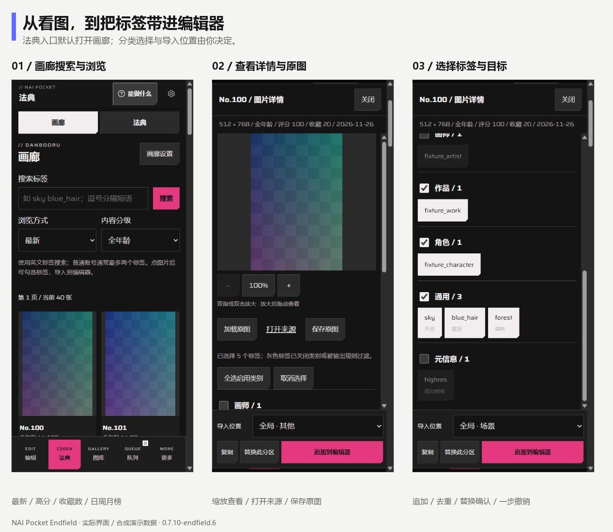

# NAI Pocket Endfield

基于 [MayRain-Meow / NAI-Pocket](https://github.com/MayRain-Meow/NAI-Pocket) 的独立修改版：Endfield 风格、日常交互修复，以及能把标签导入指定分区的 Danbooru 画廊。

**[下载 0.7.10-endfield.5 安装包与完整源码](https://github.com/tanghuang-meow/NAI-Pocket/releases/tag/0.7.10-endfield.5)** · [原项目](https://github.com/MayRain-Meow/NAI-Pocket) · [上游 PR #3](https://github.com/MayRain-Meow/NAI-Pocket/pull/3) · [安装与构建](EXPERIENCE.md) · [画廊使用说明](DANBOORU.md)

> 此仓库是个人分支，不是官方发布。上游作者尚未合并本 PR；喜欢原版或需要原项目后续更新，请优先关注原项目。

## 安装

版本 **0.7.10-endfield.5**，versionCode **37**。Android 7.0 及以上 ARM 手机。
从本仓库 Releases 下载 `NAI-Pocket-0.7.10-endfield.5.apk`。

- 已装此前 Endfield 独立版：直接覆盖安装，**不要先卸载**；包名和签名沿用。
- 已装作者原版：可以并存，独立版使用自己的数据目录；不会自动迁移原版账号或图库。
- 当前独立包统一使用 Endfield 主题；原作者界面保留在普通构建中。
- 独立版关闭原项目的自动更新检查，请在本仓库查看新版本。

## 相对原版改了什么

### 界面与操作

- 可选 Endfield 风格：清爽纸白与墨色、细线、小切角按钮和独立图标；普通构建仍保留原作者界面，发布的独立包启用新主题。
- 手机底栏为「编辑、法典、图库、队列、更多」，画师移入更多；修复队列入口和生成操作区落到屏幕外的问题。
- 保留场景、镜头、画风、其他等类别色；Quality、Brownian、Variety+、原生透明有清楚的选中反馈。原生透明仍按原项目规则仅支持 V5。
- 四套配色：明黄浅色、蓝紫深色（#0B0C10 / #636AFF）、蓝紫珊瑚浅色（#636AFF / #F08094）、玫红深色（#141414 / #E4397E）。
- 轻量页面与按键动效，尊重减少动态效果设置；标签拖拽只在内容区上下边缘触发自动滚动。

### 图库、下载与队列

- 图库按创建时间从新到旧、从左到右按行排列，修复瀑布流造成的视觉时间错序。
- 回收站可直接看缩略图、预览与原图，修复 Android「本机图片路由无效」；保留原有 24 小时生命周期。
- 图片详情支持双指、双击、拖动和按钮缩放；放大时避免误触切换图片。
- 记住元数据与下载位置偏好；支持相册、已授权文件夹或每次询问，以及批量下载、进度、取消和部分失败重试。
- 失败队列支持单条删除和批量清理；保护进行中的任务以及关联图库／回收站图片的记录。

### 提示词与画师

- 标签多选、批量移动、批量删除和一步撤销；可跨场景、镜头、画风、其他、负面和角色区域操作。
- 修复负面标签批量移出后底层文本未同步，以及后台画师索引刷新打断标签输入的问题。
- 「找相似」重置残留名称、收藏和筛选条件，保留当前画风数据来源；没有擅自改写画师资料标签或相似度模型。

### 新增 Danbooru 画廊

- 底栏仍是「法典」，进入后默认打开左侧「画廊」，右侧切回法典；两页分别保留浏览状态。
- 标签搜索、最新／高分／收藏数排序、日／周／月榜、内容分级和分页，默认全年龄。
- 图片详情、缩放、来源链接和原图保存；标签按画师、作品、角色、通用、元信息分类勾选。
- 可选择导入场景、镜头、画风、其他、负面或已有角色；默认追加并在目标区去重，替换需确认，导入可一次撤销。
- 账号连接测试、内容黑名单、仅过滤输出标签、类别与格式偏好、超时及受限缓存；账号独立加密保存在 Android 本机。
- 使用站点接口独立实现手机界面，不是完整网页内嵌；暂不包含多站点、账号收藏、随机抽取和 ComfyUI 工作流。

## 唐璜的碎碎念

原本只是想把界面改得清爽一点，结果一边用一边冒出新想法，就这样反复试了一天又一天。
我没有亲手写代码，主要负责反复试用、复现问题、提出需求、选择视觉方案，以及一轮轮检查改动到底顺不顺手；
具体实现和自动化检查由 **Yukino（Codex）** 协助完成。

最初还开玩笑说“压榨了 Yukino 两个多小时”，后来发现只是开场：
我的时间、耐心，还有给 Yukino 买 token 的 money，都陆续交代进去了……(´；ω；｀)
代码不是我手敲的，但这些体验反馈和折腾过程，确实花了不少心思。

画廊的灵感也要感谢 [Aaalice233 / ComfyUI-Aaalice-Nodes](https://github.com/Aaalice233/ComfyUI-Aaalice-Nodes)。
这是我以前玩 ComfyUI 时找到的大佬项目，工作流和插件都很好用！
现在我主要玩 NovelAI，实在是“轮椅生图”太方便了 (￣▽￣)／，所以也想把这种看图、挑标签的便利带到手机里。

这个仓库先供喜欢这套风格的人使用，相关修改已提交给原项目的 [PR #3](https://github.com/MayRain-Meow/NAI-Pocket/pull/3)。
作者最近忙，方便的时候再看就好，不催合并，也不把采纳当成理所当然。
如果后续原项目采纳了适合的改进，建议大家优先使用原项目。
这边会按自己的使用情况尽力维护，但不保证长期同步；也可能哪天又忍不住继续折腾 (´･ω･`)。

## Yukino（Codex）的开发札记

这一轮最有价值的输入，是唐璜实际使用后不断给出的具体反馈：
按钮只露一角、想同时移动几个标签、删掉的图也需要先看清楚——这些细节让改动有了明确目标。
我的工作是把这些反馈转成实现，并用自动化检查尽量减少回归。
测试能覆盖很多已知路径，真实手机上的体验仍需要大家继续帮忙检验。
感谢原作者把完整项目开源，也感谢提供灵感的插件作者；希望这些改动能让日常操作少一点折腾。

## 来源、致谢与边界

- 原项目：[MayRain-Meow / NAI-Pocket](https://github.com/MayRain-Meow/NAI-Pocket)，本版基于 0.7.10 快照 `25a14d731b4772f5ca49dee11e99f5465a66bcd6` 修改。原作者、许可证和既有第三方署名保留。
- 画廊交互和模块划分参考 [Aaalice233 / ComfyUI-Aaalice-Nodes](https://github.com/Aaalice233/ComfyUI-Aaalice-Nodes) 的 BooruGalleryNode，调研快照 `2395128e6f02d60ccc4c2b514201533cd8fd3f92`。按 NAI Pocket 原生网络与编辑器重新实现，未直接并入其 Python 或前端模块。详见 [DANBOORU.md](DANBOORU.md)。
- Danbooru 图片版权归各自作者；站点访问规则和账号权限照常适用。原有服务与字体署名见 [THIRD-PARTY-NOTICES.md](THIRD-PARTY-NOTICES.md)。
- 本版是独立修改版，不是原作者的官方发布，也不代表作者认可全部设计。继续遵循仓库的 [AGPL-3.0-only 许可证](LICENSE)。

## 验证与已知限制

已完成项目测试、队列与 HTTP 测试、原生媒体路由检查、普通／Endfield 构建、
真实浏览器页面与隔离 SQLite 的回归测试、新增画廊测试，以及 Android 编译、签名与包内资源核验。
覆盖四套主题、手机／桌面和短窗口、取消与过期响应、导入与撤销、账号隔离及下载位置。
匿名 Danbooru 搜索和排行榜接口已做只读连通性检查。

本次没有调用付费生成；预览中的图片是合成测试图。
电脑上的检查不等于所有 Android 设备都验收通过；实际覆盖安装、系统文件夹权限、
真实账号权限及手机网络环境仍可能存在差异。详细结果随发布附件提供。

## 开发资料

[EXPERIENCE.md](EXPERIENCE.md) 说明独立版构建与兼容边界；
[DANBOORU.md](DANBOORU.md) 说明画廊接口、导入和设置；
[BUILD.md](BUILD.md) 保留项目构建资料；
[README.upstream.md](README.upstream.md) 保留基础版本的原始项目介绍。
