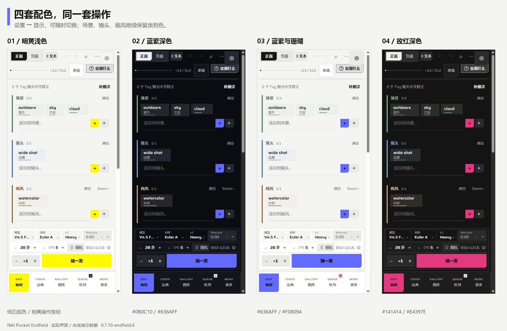
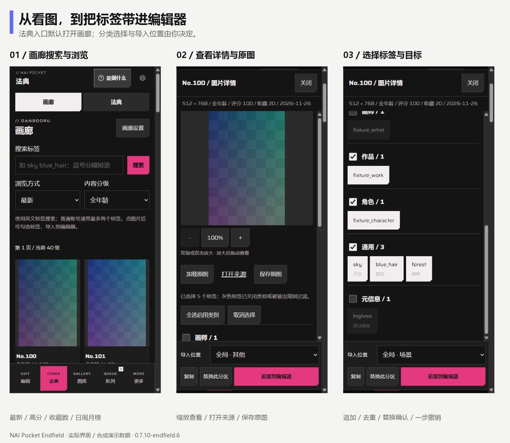
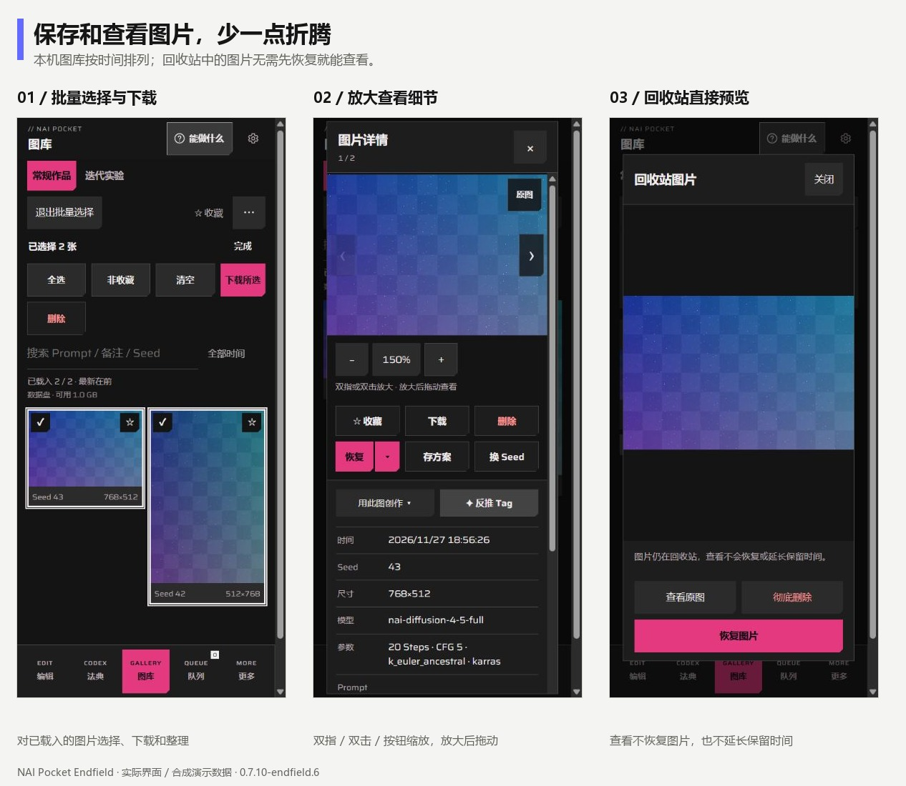
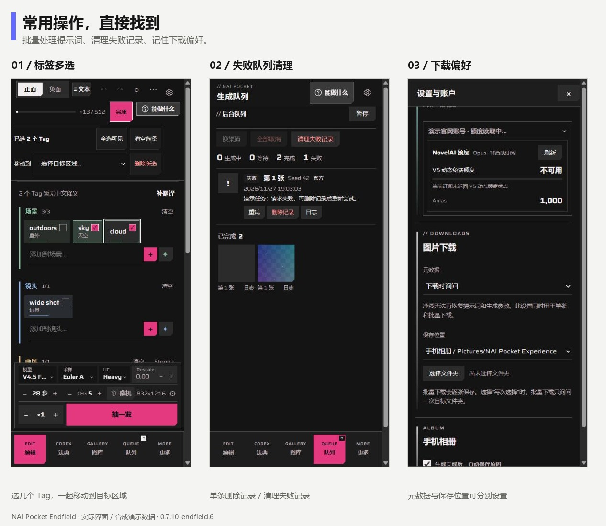
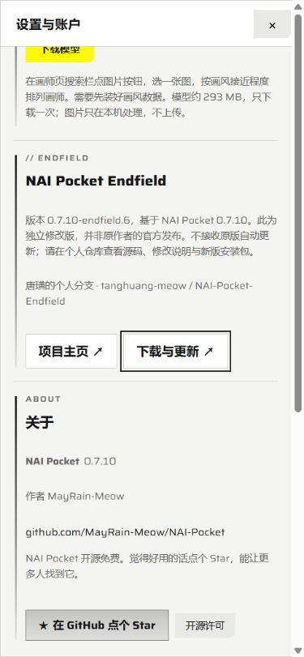

# NAI Pocket Endfield 功能图解

以下是 **0.7.10-endfield.6 实际界面**在隔离演示环境中的截图，不是概念设计。
示例图片、账号和失败任务是合成测试数据；没有使用个人图库、真实 Token 或第三方画作。
点开图片可以查看大图。截图演示界面和操作入口，不代表所有手机上的系统授权、网络和后台行为已经验收。

## 1. 四套配色与类别色

设置 → 显示：明黄浅色、蓝紫深色、蓝紫与珊瑚、玫红深色，并支持跟随系统。
场景、镜头、画风、其他的类别色独立保留，便于辨认分区。

## 2. 画廊搜索、看图与指定位置导入

进入底栏「法典」，默认打开左侧「画廊」，右侧可切回法典。
支持搜索、最新／高分／收藏数、日周月榜、分级及分页。
详情里可按类别或逐个选标签，再选择场景、镜头、画风、其他、负面提示词或已有角色。
「追加到编辑器」会对目标分区去重；「替换此分区」会先确认，两种导入均可一步撤销。
演示图中的 `fixture_*` 是测试名称；实际联网浏览显示站点返回的真实标签。

## 3. 图库、缩放与回收站

- 图库按创建时间从新到旧、从左到右排列。批量下载针对当前已载入的图片。
- 图片详情可双指、双击和按钮放大；放大后拖动查看。静态截图不能展示完整手势过程。
- 回收站可直接预览与查看原图。查看不会恢复，也不会延长原有 24 小时保留时间。

## 4. 标签多选、失败队列和下载偏好

- 编辑器「多选」：批量移动或删除，并可撤销。
- 队列「删除记录」「清理失败记录」：清理失败任务，保护进行中或仍关联图库／回收站图片的任务。
- 设置 → 图片下载：元数据可选每次询问、保留或移除；保存位置可选相册、指定文件夹或每次询问。

## 5. 个人项目入口（仅本仓库发布版）

设置 → ENDFIELD 提供「项目主页」「下载与更新」，下方「关于」继续保留原作者的项目与署名。
**个人入口只在 `endfield-release` 分支；上游 PR #3 的代码不包含它。**

## 单张原图

| 功能 | 原图 |
| --- | --- |
| 配色 | [明黄](editor-light.jpg) · [蓝紫深色](editor-dark.jpg) · [蓝紫珊瑚](editor-blue-coral.jpg) · [玫红](editor-rose-night.jpg) |
| 画廊 | [浏览](booru-browse.jpg) · [详情](booru-detail.jpg) · [标签导入](booru-import.jpg) |
| 图片 | [批量下载](gallery-batch.jpg) · [放大](image-zoom.jpg) · [回收站](trash-preview.jpg) |
| 整理 | [标签多选](tags-batch.jpg) · [失败队列](queue-cleanup.jpg) · [下载偏好](download-preferences.jpg) |
| 项目 | [个人仓库入口](settings-project.jpg) |

[返回项目首页](../../README.md) · [画廊详细用法](../../DANBOORU.md)
